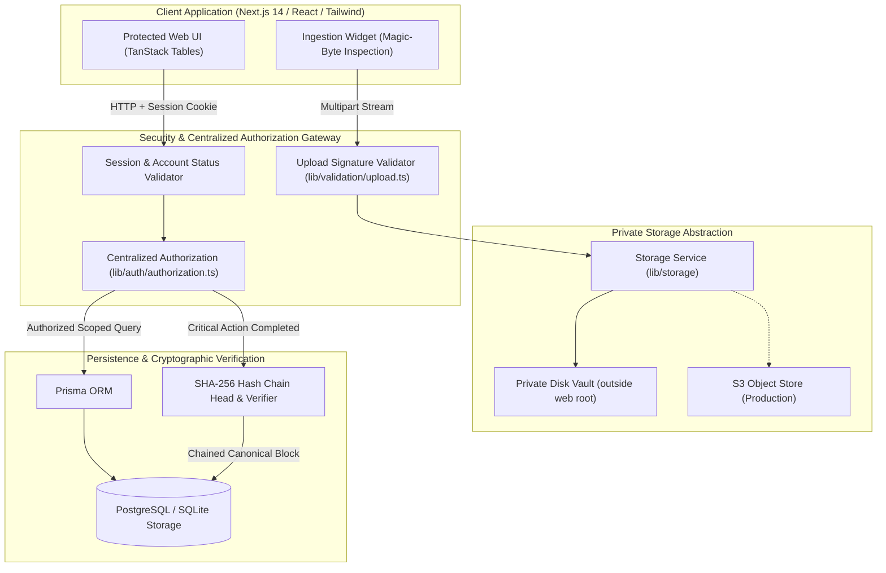

# TrustVault

**Secure Document Sharing Platform with Verifiable Cryptographic Audit Trails**

TrustVault is an enterprise document security platform designed around zero-trust architecture, server-side authorization, immutable cryptographic hash-chain audit logging, and private file storage.

---

## 1. System Architecture



---

## 2. Core Security Guarantees

1. **Deny-by-Default Server Authorization**: Every route, preview, download stream, mutation, and query enforces server-side authorization. Knowing a document ID, URL, filename, or storage key never grants access.
2. **True IDOR / Enumeration Defense**: Requests for unauthorized documents return HTTP 404 (or 403 where disclosing existence is an explicit policy decision), completely preventing resource enumeration.
3. **Strict Separation of Administrative Roles**: Administrators have visibility over user accounts, system metrics, and audit logs, but **cannot automatically read or download confidential files** without explicit owner delegation. There is zero administrator bypass.
4. **Immediate Revocation**: Document authorization is evaluated directly against the database on every request. Revoking a permission grant denies the very next request instantly with zero token or caching delay.
5. **Verifiable Audit Hash Chain**: Every sensitive event is linked using canonical SHA-256 cryptographic hashing to the preceding block. Any tampering with past events, sequence disruption, or silent deletion breaks the chain and is reported by the verification utility.
6. **Isolated Private Storage**: Files are stored with random UUID keys in private application-controlled storage outside the public web root. File downloads are streamed through an authenticated application proxy with `Content-Disposition: attachment`, `X-Content-Type-Options: nosniff`, and `Cache-Control: no-store` headers.

---

## 3. Role & Permission Matrix

| Operation | Administrator | Document Owner | Viewer (READ) | Viewer (EDIT) |
| :--- | :---: | :---: | :---: | :---: |
| View System Admin Console & Metrics | ✅ | ❌ | ❌ | ❌ |
| Manage User Accounts & Deactivation | ✅ | ❌ | ❌ | ❌ |
| Inspect System-Wide Audit Trail | ✅ | ❌ | ❌ | ❌ |
| Run Audit Hash-Chain Verification | ✅ | ❌ | ❌ | ❌ |
| Upload Confidential Documents | ✅ (for self) | ✅ | ❌ | ❌ |
| View Owned Document Details & Metadata | ✅ (if owner) | ✅ | ✅ (if granted) | ✅ (if granted) |
| Download Confidential Document Bytes | ❌ (requires grant) | ✅ | ✅ | ✅ |
| Edit Document Metadata (Title, Scope) | ❌ | ✅ | ❌ | ✅ |
| Grant / Delegate Document Permissions | ❌ | ✅ | ❌ | ❌ |
| Revoke Document Permission Grants | ❌ | ✅ | ❌ | ❌ |
| Delete Document from Vault | ❌ | ✅ | ❌ | ❌ |
| Inspect Document Audit History | ❌ | ✅ | ❌ | ❌ |

---

## 4. Technology Stack

- **Frontend**: Next.js 14 (App Router), TypeScript, React 18, Tailwind CSS, Lucide Icons, React Hook Form, Zod.
- **Backend**: Next.js Server-Side Route Handlers, Node.js 20+, Centralized Authorization Service.
- **Database & ORM**: PostgreSQL (Production) / SQLite (Zero-Config Development), Prisma ORM v5.22.
- **Authentication**: Server-managed database sessions, HTTP-only SameSite cookies, Argon2id memory-hardened password hashing.
- **Storage**: Private filesystem abstraction (`./storage/vault_data`) with path traversal guards and S3 compatibility interface.
- **Testing**: Vitest automated security test suite (31 comprehensive security assertions).
- **DevOps**: Docker, Docker Compose, Multi-stage Dockerfile with non-root security.

---

## 5. Demo Accounts & Local Development Credentials

For local evaluation, the following pre-seeded demo accounts are available with the default demo password:

**Default Password**: `Password123!`

| Role | Account Email | Purpose & Scope |
| :--- | :--- | :--- |
| **System Administrator** | `admin@example.test` | User management, system metrics, and audit log verification. (Cannot access confidential files without a grant). |
| **Document Owner A** | `owner-a@example.test` | Owns Financial Audit Report, Security Compliance Matrix, and private M&A Strategy document. |
| **Document Owner B** | `owner-b@example.test` | Owns Cryptographic Keys Rotation Schedule and Executive Compensation documents. |
| **Viewer A** | `viewer-a@example.test` | Granted READ access to Owner A's Financial Audit Report. |
| **Viewer B** | `viewer-b@example.test` | External Auditor without initial grants. |
| **Deactivated User** | `deactivated-user@example.test` | Terminated account for testing 403 access denial. |

The login screen includes a **1-Click Demo Credential Selector** to easily switch between roles.

---

## 6. Getting Started & Local Setup

### 6.1 Prerequisites
- Node.js v18+ (tested on Node.js v20 and v24)
- npm v9+

### 6.2 Installation & Database Setup
```bash
# 1. Clone repository and install dependencies
git clone <repo-url> TrustVault
cd TrustVault
npm install

# 2. Configure environment
cp .env.example .env

# 3. Synchronize database schema and generate Prisma client
npx prisma db push

# 4. Seed demo accounts, documents, synthetic files, and audit genesis chain
node prisma/seed.js

# 5. Start development server
npm run dev
```

Open [http://localhost:3000](http://localhost:3000) in your browser.

---

## 7. Running the Automated Security Test Suite

The security test suite executes 31 server-side assertions covering cross-user isolation, IDOR, immediate revocation, upload signature spoofing, path traversal, hash-chain tampering, and regression verification.

```bash
# Run all security tests via Vitest
npm test
```

### Verified Test Results:
```text
 ✓ tests/document-isolation.test.ts (9 tests)
 ✓ tests/admin-boundaries.test.ts (5 tests)
 ✓ tests/upload-security.test.ts (6 tests)
 ✓ tests/audit-tamper.test.ts (3 tests)
 ✓ tests/auth.test.ts (4 tests)
 ✓ tests/revocation.test.ts (1 test)
 ✓ tests/regression.test.ts (1 test)
 ✓ tests/sanity.test.ts (2 tests)

 Test Files  8 passed (8)
      Tests  31 passed (31)
   Duration  8.87s
```

---

## 8. Production Deployment & Docker Compose

TrustVault includes a multi-stage Dockerfile and Docker Compose configuration orchestrating PostgreSQL 16 Alpine and the Next.js production container.

```bash
# Start full PostgreSQL and TrustVault production stack
docker-compose up -d --build
```

### Production Checklist
1. Change default database passwords in `.env` and `docker-compose.yml`.
2. Generate a secure random 32-character string for `SESSION_SECRET`.
3. Set `COOKIE_SECURE=true` behind an SSL/TLS reverse proxy.
4. Mount persistent volumes for `/app/storage/vault_data` or configure S3 environment variables.

---

## 9. Documentation Links

- **Threat Model**: [THREATS.md](file:///c:/Users/krish/OneDrive/Desktop/TrustVault__/THREATS.md)
- **API Reference**: [API.md](file:///c:/Users/krish/OneDrive/Desktop/TrustVault__/API.md)
- **AI Development Log**: [PROMPTS.md](file:///c:/Users/krish/OneDrive/Desktop/TrustVault__/PROMPTS.md)

---

## 10. Security Assumptions & Limitations

- **Database-Resident Hash Chain**: The cryptographic hash chain guarantees detection of unauthorized row modifications or sequence gaps. However, a database superuser with raw disk/root access could recompute hashes unless the latest chain head is anchored to an external WORM store or ledger.
- **Antivirus Scanning**: File headers and magic bytes are validated on the server. For binary heuristic inspection of macro-enabled documents, an external scanner daemon should be attached to the validation pipeline hook in `lib/validation/upload.ts`.
